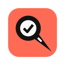
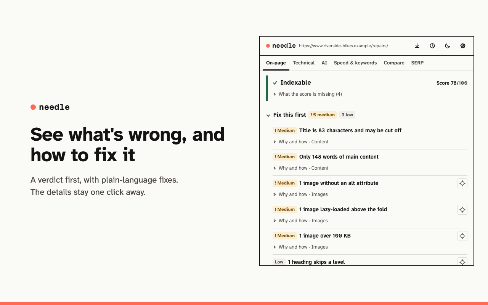
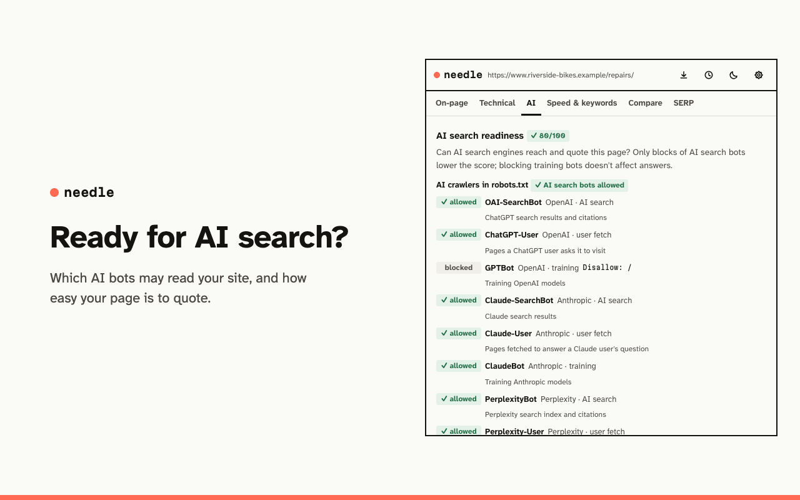

<p align="center">
  
</p>

<h1 align="center">Needle</h1>

<p align="center">
  <strong>All-in-one SEO and GEO tool for Chrome.</strong><br>
  See what search engines and AI assistants see on any page, and what to fix first.
</p>

<p align="center">
  <a href="#get-it">Get it</a> ·
  <a href="#what-it-checks">What it checks</a> ·
  <a href="#privacy">Privacy</a> ·
  <a href="CONTRIBUTING.md">Contributing</a>
</p>

<p align="center">
  <a href="https://chromewebstore.google.com/detail/needle-all-in-one-seo-geo/khjcjeainolgjipkcjnfaoepnjomnfjc"></a>
  <a href="https://github.com/Izey-Van-der-haeghen/needle/actions/workflows/test.yml"></a>
  <a href="LICENSE"></a>
  
</p>



- **One list of what to fix first.** Every check, from robots.txt to alt text, ends in one list, most important first, each with why it matters and how to fix it. Show them all on the page in one click.
- **Built for AI search too.** It covers classic SEO and optimising for AI search, whatever you call it: GEO, AEO, LLMO or AI SEO. See which AI bots may read the page and how easy it is to quote.
- **Private by default.** No server, no analytics, no account for the on-page, technical and AI checks. Needle installs with no access to websites and reads a page only when you open it there, or, in the side panel, the tab you switch to.

## What it checks

**Fix this first.** The list on top of the On-page tab: mark every problem on the page in one click, or copy the list for a developer or as a ready-made prompt for your AI assistant.

**On-page**
- Indexability verdict: HTTP status, redirects, robots meta and googlebot tags, X-Robots-Tag, robots.txt and canonical, each with a plain-language fix
- Title and meta description with character count, pixel width and a Google result preview
- Headings outline with skipped levels, shown on the page if you want
- Links by page region (header, menu, breadcrumb, main content, sidebar, footer), nofollow, sponsored and ugc, and an optional check of every link
- Content images: missing alt text, large files, lazy loading above the fold, missing width and height, unclear file names
- Structured data: JSON-LD checked against Google's required and recommended properties, microdata and RDFa types listed, with suggestions
- Hreflang validation, Open Graph and X card previews, word counts, readability and keyword placement

**Technical**
- Server answer, response headers, HTTPS, HSTS and mixed content
- robots.txt matched the way Google does (RFC 9309) and the XML sitemap
- The server's HTML compared with the page after JavaScript
- Snippet controls (nosnippet, max-snippet, data-nosnippet) that limit quotes in search and AI Overviews
- http, https, www and non-www versions: do they all end on one URL?

**AI search** (its own tab)
- Which AI search bots, training bots and user-fetch bots robots.txt allows for this page, what each bot does, and the rule that blocks it
- Trust signals (author, dates, sources, organisation) and how easy the page is to quote
- llms.txt, for information



**With your own keys** (optional)
- Google PageSpeed Insights for mobile and desktop, and the 25-week Core Web Vitals trend from the Chrome UX Report (free Google API key)
- Clicks, impressions, queries and last crawl from Bing Webmaster Tools (free Bing API key)
- Keywords a page ranks for, a site's organic traffic and Google's top 20 for a keyword with AI Overview sources, through your own [DataForSEO](https://dataforseo.com) account (pay per use; the cost is shown before every lookup). Side-by-side comparison with competitor pages works without it; DataForSEO only adds their Google positions.

Settings shows where to find each key.

**Work the way you like.** Popup or side panel that follows your tabs, a right-click menu, keyboard shortcuts, light and dark theme, an HTML audit report, CSV and Markdown exports, and "what changed since your last audit".

## Get it

- **Chrome Web Store:** [install Needle](https://chromewebstore.google.com/detail/needle-all-in-one-seo-geo/khjcjeainolgjipkcjnfaoepnjomnfjc), free.
- **Load it from source:** see [Install from source](#install-from-source).
- **What's new:** every version's changes are in the [changelog](CHANGELOG.md).
- **Questions and bugs:** [GitHub issues](https://github.com/Izey-Van-der-haeghen/needle/issues) or hello@izey.dev.

## Privacy

- Needle reads the page in the tab you open it on, when you open it. In the side panel, with access to websites allowed, it also audits the tab you switch to while the panel is open. It never reads tabs in the background, form fields or passwords.
- Results, history and your API keys stay in Chrome on your device. Keys are never synced.
- A page address leaves your browser only when you start a check that sends it: to Google (PageSpeed, Chrome UX Report), Microsoft (Bing Webmaster Tools) or DataForSEO, each with your own key or login. Links to other tools open them with the page address, only when you click.
- The full policy: [izey.dev/needle/privacy](https://izey.dev/needle/privacy/).

## Permissions

| Permission | Why |
|---|---|
| `activeTab`, `scripting` | Read the tab you open Needle on, and mark headings, links or problems on that page when you ask. |
| `storage` | Keep results, history, change snapshots, settings and your API keys on this device. |
| `sidePanel`, `contextMenus` | Optional side panel mode, and "Audit this page" / "Compare this link's page" in the right-click menu. |
| Access to websites (optional) | Off until a feature asks for it: link checks, competitor pages, hreflang alternates, image file sizes, the http/https/www check, a side panel that follows your tabs, and the DataForSEO and Bing APIs. |

None of these shows a warning at install. There is no content script on every page.

## Accessibility

Built to WCAG 2.2 AA in light and dark: contrast, focus and keyboard use have been measured. Every status uses a word and a symbol, not colour alone. Single-key shortcuts can be turned off in Settings. Found a barrier? Please [open an issue](https://github.com/Izey-Van-der-haeghen/needle/issues).

## Install from source

1. `npm install`, then `npm test` to check that everything passes.
2. Open `chrome://extensions`, turn on **Developer mode**, click **Load unpacked** and choose this folder.
3. Pin Needle in the toolbar, open any web page and click the Needle button, or press Alt+Shift+N.

After changing files, click the reload icon on Needle's card in `chrome://extensions`.

## Development

Plain JavaScript ES modules, no build step and no runtime dependencies.

| Command | What it does |
|---|---|
| `npm test` | Runs the test suite ([Vitest](https://vitest.dev)); `content.js` runs in jsdom through `tests/helpers/content-harness.js`. |
| `npm run package` | Builds `dist/needle-<version>.zip` for the Chrome Web Store from an allow-list of files, and refuses to build when a placeholder or a forbidden word is left in them. |
| `npm run lint:extension` | Lints the store package with Mozilla's [addons-linter](https://github.com/mozilla/addons-linter), read for Chrome: Firefox-only notes are dropped, and a new unescaped HTML assignment fails until it is checked. `node tools/lint-extension.mjs --prove` first shows it catches planted problems. |
| `node dev/preview/serve.js` | Serves the real popup and settings page at http://localhost:5178, to open in a normal browser tab, with a stubbed `chrome` API and a fictional demo page. See [dev/preview/README.md](dev/preview/README.md). |
| `npm run icons` | Redraws the icons (needs Python with Pillow). |

```
manifest.json        Manifest V3, minimal permissions
background.js        Service worker: keyed lookups, link checks, image sizes, cache, side panel, right-click menu
content.js           Injected on demand: reads the page, marks headings, links and problems
popup.html/js/css    The popup, also used as the side panel
options.html/js/css  Settings
privacy.html         Privacy policy
base.css             Shared colour tokens and components, light and dark
lib/                 Analysis and helpers: robots, technical, findings, AI search, schema, hreflang, export…
tests/               Vitest suites and fixture pages
dev/preview/         Preview harness, demo site and store image scripts
store/               Chrome Web Store listing text and images
tools/               Packaging and icon scripts
```

## Contributing

Issues and pull requests are welcome. Please read [CONTRIBUTING.md](CONTRIBUTING.md) first; security problems go to [SECURITY.md](SECURITY.md).

## Licence

MIT, see [LICENSE](LICENSE). The fonts in `fonts/` keep their own SIL Open Font License 1.1.

## Credits

Made by Izey Van der Haeghen. Typefaces: [Atkinson Hyperlegible Next](https://github.com/googlefonts/atkinson-hyperlegible-next) and [Martian Mono](https://github.com/evilmartians/mono), both under the SIL Open Font License 1.1.
